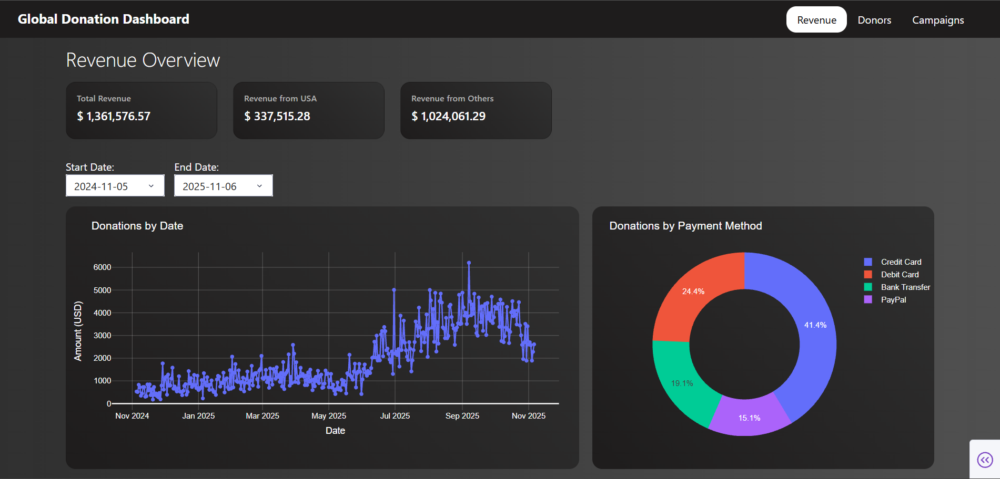
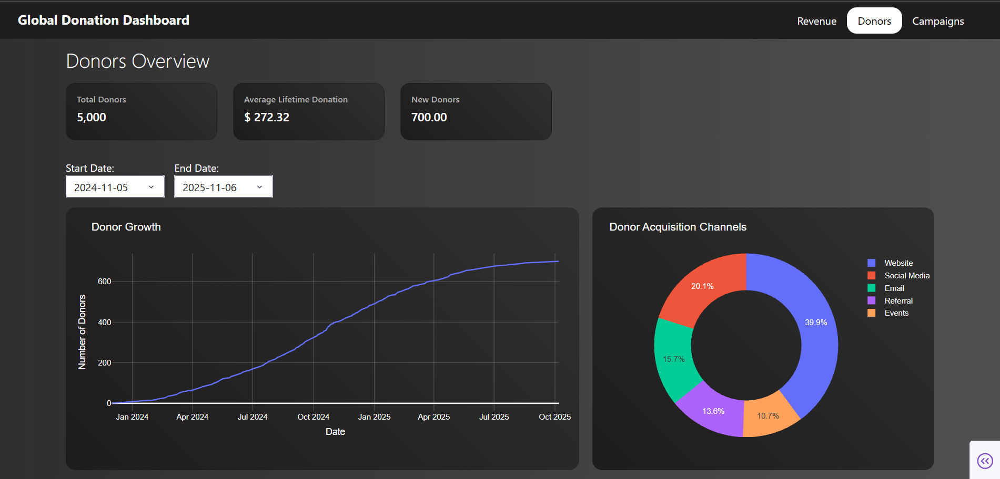
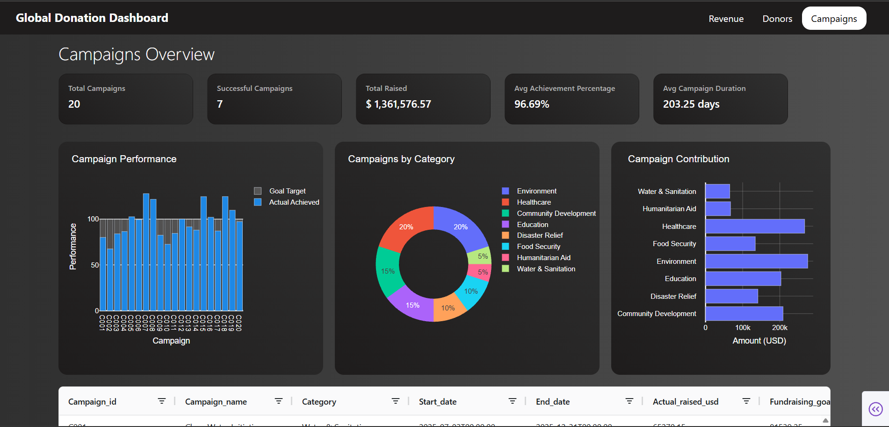

# Global Donation Dashboard

An interactive business intelligence dashboard built with **Python**, **Dash**, **Plotly**, and **Pandas** to analyze international donation revenue, donor behavior, and fundraising campaign performance for a fictional non-profit organization.

The project recreates a real-world non-profit analytics use case using entirely synthetic data, providing an interactive view of fundraising performance across countries, donation channels, donor segments, and campaigns.

## Dashboard Overview
The application consists of three analytical pages:

### 1. Revenue
Provides an overview of donation revenue and its distribution across countries, payment methods, and donation types.



**KPI Metrics**
*	Total Revenue
*	Revenue from USA
*	Revenue from Other Countries

**Filters**
* Start Date
* End Date

**Visualizations**
*	**Donations by Date**: Line chart showing donation revenue trends over time.
*	**Donations by Payment Method**: Donut chart showing the distribution of revenue across payment methods.
*	**Donations by Type**: Donut chart comparing one-time and recurring donations.
*	**Top 10 Donating Countries**: Bar chart ranking countries by total donation revenue.

### 2. Donors
Provides insights into donor acquisition, growth, geographic distribution, and contribution patterns.



**KPI Metrics**
*	Total Donors
*	Average Lifetime Donation
*	New Donors

**Filters**
*	Start Date
*	End Date

**Visualizations**
*	**Donor Growth**: Line chart tracking donor growth over time.
*	**Donation Acquisition Channel**: Donut chart showing the distribution of donors across acquisition channels.
*	**Donor Type**: Donut chart comparing individual and organizational donors.
*	**Donors by Country**: Bar chart showing donor distribution across countries.

### 3. Campaigns
Provides an overview of fundraising campaign performance, fundraising targets, and campaign contributions.



**KPI Metrics**
*	Total Campaigns
*	Successful Campaigns
*	Total Raised
*	Average Achievement Percentage
*	Average Campaign Duration

**Visualizations**
*	**Campaign Performance**: Stacked bar chart comparing campaign fundraising goals against actual amounts raised.
*	**Campaigns by Category**: Donut chart showing the distribution of campaigns across categories.
*	**Campaign Contribution**: Horizontal bar chart ranking campaigns by their contribution to total fundraising revenue.

**Campaign Data Table**<br>
An interactive AG Grid table provides detailed campaign-level information, allowing users to explore and compare individual campaigns.

## Technology Stack

| Technology | Purpose |
| ---------- | ------- |
| Python | Application development and data processing |
| Dash | Interactive dashboard framework |
| Plotly | Interactive data visualizations |
| Pandas | Data manipulation and aggregation |
| NumPy | Synthetic data generation |
| Dash AG Grid | Interactive campaign data table |
| CSS | Dashboard styling and layout |

## Dataset
The dashboard uses synthetic data generated specifically for this project. No real donor information or organizational financial records are used.

The dataset consists of four related CSV files:

| Dataset | Description |
| ------- | ----------- |
| ```donations.csv``` | Donation transactions, including dates, amounts, currencies, payment methods, and donation types |
| ```donors.csv``` | Donor information, including country, donor type, acquisition channel, and lifetime contribution |
| ```campaigns.csv``` | Campaign information, including categories, fundraising goals, actual amounts raised, and achievement percentages |
| ```countries.csv``` | Country reference data, including country codes, continents, currencies, and exchange rates |

The generated dataset represents three years of donation history, covering 2023–2025.

All monetary values are normalized to USD for consistent financial aggregation. Exchange rates are illustrative rather than historical market rates.

## Running the Application Locally
### Clone the repository
```bash
git clone
cd nonprofit-analytics
```
### Create a virtual environment
```bash
python -m venv .venv
```
Activate the environment:
**Windows**
```bash
.venv\Scripts\activate
```
**Linux / macOS**
```bash
source .venv/bin/activate
```
### Install dependencies
```bash
pip install -r requirements.txt
```
### Generate the synthetic datasets
```bash
python scripts/generate_data.py
```
### Run the dashboard
```bash
python app.py
```

## Project Structure
```text
nonprofit-analytics/
│
├── app.py
├── requirements.txt
│
├── data/
│   ├── donations.csv
│   ├── donors.csv
│   ├── campaigns.csv
│   └── countries.csv
│
├── scripts/
│   └── generate_data.py
│
├── analytics/
│   ├── campaigns.py
│   ├── donations.py
│   ├── donors.py
│
├── components/
│   ├── callbacks.py
│   ├── comp_bar.py
│   ├── input_comps.py
│   ├── metric_card.py
│   ├── navbar.py
│   └── titlebar.py
│
├── pages/
│   ├── revenue.py
│   ├── donors.py
│   └── campaigns.py
│
└── assets/
    └── styles.css
```
## Project Objectives
*	Develop an interactive business intelligence dashboard using Dash and Plotly.
*	Track fundraising revenue and donation trends over time.
*	Analyze donor acquisition and geographic distribution.
*	Evaluate fundraising campaign performance against established targets.
*	Build reusable data processing and KPI calculation components.
*	Present business metrics through interactive visualizations and data tables.

## Data Disclaimer
Global Donation Dashboard is an independent portfolio project created for demonstration purposes.

All datasets and organizational information are fictional and synthetically generated. The project is not affiliated with or representative of any actual non-profit organization.

***

**Built with Python, Dash, Plotly, and Pandas.**